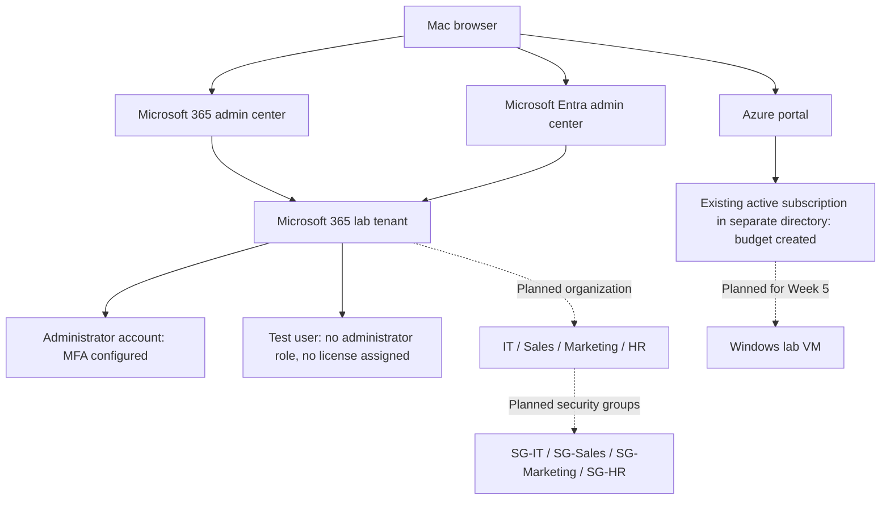

# Lab Environment

Status: Initial diagram based on learner-reported setup. Planned components are labeled explicitly.

## Evidence and Limitations

- Microsoft 365 Business Premium account setup, administrator MFA, contract review, and test-user creation were reported complete by the learner.
- The learner confirmed an existing active Azure subscription in a directory separate from the Microsoft 365 lab and reported creating a budget on October 25, 2026. The learner reviewed the amount, currency, alert conditions, and recipients and reported no issues. Exact values are not recorded; notification delivery remains untested.
- The learner reported saving and checking the test user's Department (Sales) and Job title (Sales Representative). Security groups and memberships remain proposed.
- Test-user sign-in was reported successful on October 25, 2026. Access to licensed services remains unverified.
- No Windows VM deployment is recorded.
- Tenant identifiers and account names are omitted from this public diagram.
